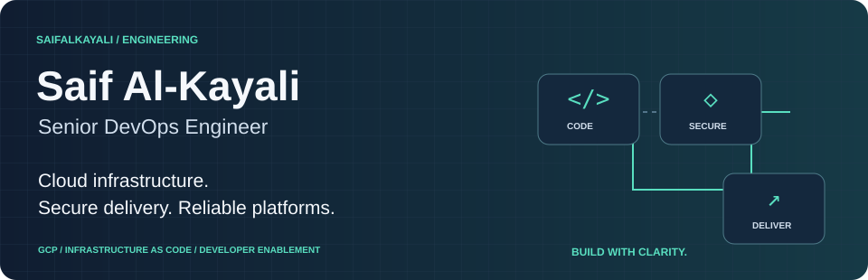
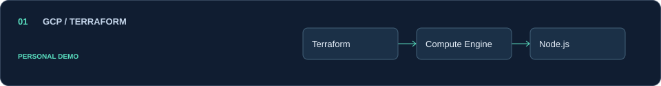
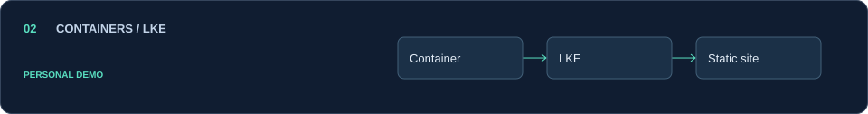
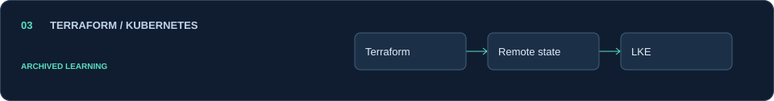

[Website](https://saifalkayali.com) · [LinkedIn](https://www.linkedin.com/in/saif-alkayali) · [Resume](https://drive.google.com/drive/folders/1pmyJsERc_RFoA6JundomnmYL2k8fn1UF) · [Public repositories](https://github.com/Saifalkayali?tab=repositories)

## Engineering with clarity

I build cloud infrastructure and delivery platforms that help engineering teams ship securely and operate reliably. My strongest cloud platform is Google Cloud, with earlier AWS infrastructure and SRE experience and cross-cloud work involving Azure and SaaS integrations.

Alongside hands-on engineering, I provide technical leadership through architecture decisions, delivery standards, and developer enablement.

### Core platforms & delivery

<p>
  
  
  
  
  
</p>

**Primary cloud: Google Cloud** · Earlier AWS infrastructure and SRE experience · Cross-cloud work involving Azure

## Engineering focus

- **Cloud infrastructure:** Terraform-based infrastructure as code, repeatable environments, and practical cloud operations.
- **Secure software delivery:** GitHub Actions, CI/CD modernization, and security and software-supply-chain controls in delivery workflows.
- **Reliability and observability:** Monitoring, logging, operational troubleshooting, and maintainable services.
- **Enterprise integrations:** Connecting cloud services and enterprise platforms with attention to access, delivery, and operational support.
- **Developer enablement:** Reusable workflows, clear documentation, and engineering practices that make delivery easier to maintain.

My AI-related work focuses on infrastructure supporting AI-enabled applications and governed engineering workflows.

## Selected public work

> **Personal learning & demonstration projects.** These illustrate specific infrastructure patterns, not production-ready platforms or employer implementations.

### 01 · [GCP Terraform web app](https://github.com/Saifalkayali/gcp-terraform-web-app)

[](https://github.com/Saifalkayali/gcp-terraform-web-app)

Small Compute Engine and Terraform demo with a Node.js “Hello, World!” application, created for Copilot testing.

[Explore repository →](https://github.com/Saifalkayali/gcp-terraform-web-app)

### 02 · [Static site on LKE](https://github.com/Saifalkayali/lke-saif-site)

[](https://github.com/Saifalkayali/lke-saif-site)

Containerized static-site deployment demo for Linode Kubernetes Engine, paired with the Terraform learning project below.

[Explore repository →](https://github.com/Saifalkayali/lke-saif-site)

### 03 · [Terraform and Kubernetes on Linode](https://github.com/Saifalkayali/terraform-k8s-linode)

[](https://github.com/Saifalkayali/terraform-k8s-linode)

Archived learning project covering LKE provisioning, remote-state configuration, and a static-site deployment walkthrough. Historical reference, not current deployment guidance.

[Explore repository →](https://github.com/Saifalkayali/terraform-k8s-linode)

<details>
<summary><b>⌘ Explore the demos locally</b></summary>

Read each repository’s documentation before trying it. Cloud provisioning can incur charges; the archived Linode project is historical reference only.

```bash
git clone https://github.com/Saifalkayali/gcp-terraform-web-app.git
git clone https://github.com/Saifalkayali/lke-saif-site.git
git clone https://github.com/Saifalkayali/terraform-k8s-linode.git
```

</details>

---

**Build with clarity. Deliver with care.**

[Website](https://saifalkayali.com) · [LinkedIn](https://www.linkedin.com/in/saif-alkayali) · [Resume](https://drive.google.com/drive/folders/1pmyJsERc_RFoA6JundomnmYL2k8fn1UF) · [Public repositories](https://github.com/Saifalkayali?tab=repositories)
