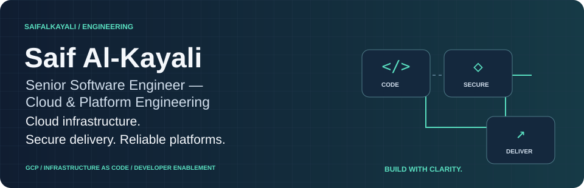
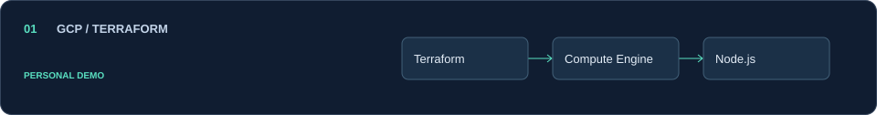
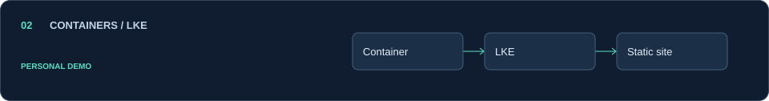

[Website](https://saifalkayali.com) · [LinkedIn](https://www.linkedin.com/in/saif-alkayali) · [Resume](https://drive.google.com/drive/folders/1pmyJsERc_RFoA6JundomnmYL2k8fn1UF) · [Public repositories](https://github.com/Saifalkayali?tab=repositories)

## Senior Software Engineer — Cloud & Platform Engineering

Based in Minneapolis–St. Paul.

I build cloud infrastructure and delivery platforms that help engineering teams ship securely and operate reliably. My strongest cloud platform is Google Cloud, with earlier AWS infrastructure and SRE experience and cross-cloud work involving Azure and SaaS integrations.

Alongside hands-on engineering, I provide technical leadership through architecture decisions, delivery standards, peer review, mentoring, and developer enablement.

### Core platforms & delivery

<p>
  
  
  
  
  
</p>

**Primary cloud: Google Cloud** · Earlier AWS infrastructure and SRE experience · Cross-cloud work involving Azure

## Engineering focus

- **Cloud infrastructure:** Terraform-based infrastructure as code, repeatable environments, and practical cloud operations.
- **Secure software delivery:** GitHub Actions, CI/CD modernization, and security and software-supply-chain controls in delivery workflows.
- **Reliability and observability:** Monitoring validation, operational troubleshooting, disaster-recovery readiness, and maintainable services.
- **Enterprise integrations:** Connecting cloud services and enterprise platforms with attention to access, delivery, and operational support.
- **Developer enablement:** Reusable workflows, rules-based intake automation, clear ownership, and documentation that help engineers work independently while preserving human review.

My AI-related work focuses on infrastructure supporting AI-enabled applications and governed engineering workflows, with clear boundaries for automation and human oversight.

## Selected public work

> **Personal learning & demonstration projects.** These illustrate specific infrastructure patterns, not production-ready platforms or employer implementations.

### 01 · [GCP Terraform web app scaffold](https://github.com/Saifalkayali/gcp-terraform-web-app)

[](https://github.com/Saifalkayali/gcp-terraform-web-app)

Terraform configuration for Compute Engine and a minimal Node.js “Hello, World!” server, created for Copilot testing. Application installation and startup on the VM are not implemented; this is an infrastructure scaffold, not a verified end-to-end deployment.

[Explore repository →](https://github.com/Saifalkayali/gcp-terraform-web-app)

### 02 · [Historical static-site example for LKE](https://github.com/Saifalkayali/lke-saif-site)

[](https://github.com/Saifalkayali/lke-saif-site)

Historical learning example with a Hugo/NGINX Dockerfile and Kubernetes Deployment and LoadBalancer Service manifests for Linode Kubernetes Engine. Public setup instructions are incomplete and rely on a companion guide that is no longer publicly accessible. A current working deployment has not been verified.

[Explore repository →](https://github.com/Saifalkayali/lke-saif-site)

<details>
<summary><b>⌘ Inspect the source locally</b></summary>

Cloning retrieves the source only. The GCP app deployment and LKE public setup instructions are incomplete; review the implementation before attempting any cloud deployment. Cloud provisioning can incur charges.

```bash
git clone https://github.com/Saifalkayali/gcp-terraform-web-app.git
git clone https://github.com/Saifalkayali/lke-saif-site.git
```

</details>

---

**Build with clarity. Deliver with care.**

[Website](https://saifalkayali.com) · [LinkedIn](https://www.linkedin.com/in/saif-alkayali) · [Resume](https://drive.google.com/drive/folders/1pmyJsERc_RFoA6JundomnmYL2k8fn1UF) · [Public repositories](https://github.com/Saifalkayali?tab=repositories)
